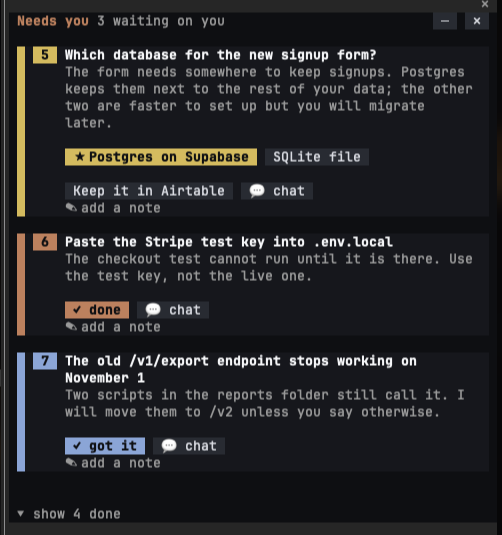
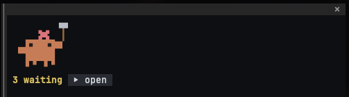
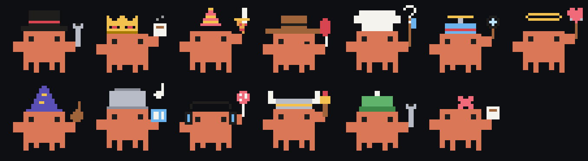

# needs-you

A Claude Code mod. Everything Claude needs from you lands in one side pane: decisions to make, things to do outside the chat, things you should know. You answer there. The transcript stays quiet.

<p align="center"></p>

## Why

Working with an agent means a lot of scrolling back to find the one line that actually needed you: *which option?*, *did you paste the key?*, *heads up, the old endpoint goes away*. Those questions get buried under tool output and narration.

needs-you gives Claude a `pin` tool and a standing instruction to use it the moment something needs you, not at the end of a long reply. Each pin becomes a card in a docked pane. You answer on the card and the answer reaches Claude as a normal message. Nothing else changes about how you work.

## Install

At the prompt of a terminal session:

```
/plugin install needs-you --marketplace brandon-stride/needs-you
```

Answer `y` to add the marketplace, then pick a scope. From a shell: `claude plugin install needs-you --marketplace brandon-stride/needs-you`. In the desktop app: **+** next to the prompt, **Plugins**, add the marketplace `brandon-stride/needs-you`, then add the plugin.

The pane docks beside the transcript in fullscreen terminals of 110 columns or more, and sits above the prompt in narrower ones. Pictures (the mascot) need a terminal with the kitty graphics protocol: Ghostty, kitty, WezTerm, iTerm2 3.5. Elsewhere it falls back to half-block pixels.

## What you see

The pane shows one item at a time, every word of it: the question, the reason, and the ways to answer. `‹ ›` steps through them, `≡` lists them all by title (press a title to open it), and answering one moves on to the next one waiting.

Each kind has a colour:

| Kind | Colour | Answer with |
| --- | --- | --- |
| decide | amber | one option per row, the recommendation starred |
| do | clay | `✓ done` once you have done it |
| know | sky | `✓ got it` |

Every card also takes a note (context, a correction), has `💬 talk it over`, which brings the item into the conversation, and `✕ not needed`, which drops it and tells Claude.

Your answer goes to Claude quietly while a turn runs, or as a prompt when the session is idle. An answered item says "sending", then "Claude has it", and leaves when that turn ends. Answer in chat instead and Claude closes the item itself: it sees what is waiting beside each message you type. Helper agents can pin too; the card says who asked.

Pins stay short so the narrow pane can show them whole: a title under 100 characters, a reason under 400, options of a few words. Claude gets the limits up front, and a pin over them, or one asking what an open item already asks, is sent back to it with the reason.

**Focus mode** (on by default) hides tool rows in the transcript and folds Claude's working narration once a turn ends, so what stays on screen is the answer and the pane. Press `ctrl+o` to see everything, or turn it off below.

**The mascot** is a pixel Clawd who lives in the minimized pane: a random hat, something in hand, a dance while items wait, a reaction when you press something, and a nap when nothing does.

<p align="center"></p>

<p align="center"></p>

## Commands

| Command | Does |
| --- | --- |
| `/needs-you` | open the pane |
| `/needs-you add <text>` | pin a reminder of your own |
| `/needs-you focus on` / `off` | focus mode |
| `/needs-you catch on` / `off` | the reply catcher, which pins questions Claude asked in prose but forgot to pin |
| `/needs-you list` / `card` | the list of titles, or one item in full |
| `/needs-you clear` | drop every item (Claude is told) |

`─` minimizes the pane, `✕` or Escape closes it until the next pin. While items wait and the pane is off screen, a line under the prompt says so.

## How it works

- `hooks/register.tsx` holds every hook: the tools Claude calls (`pin`, `resolve`, `update`, `list`), the system-prompt section that tells it when to pin, turn tracking, the pane, focus mode and the command.
- `hooks/items.ts` is pure logic: parsing pins, building the messages, the seen/archive rules, the reply catcher.
- `hooks/clawd.ts` draws the mascot on a 30×28 pixel grid and turns it into RGBA for a terminal image or half-block cells for a raster.
- `types/index.d.ts` is the state contract the engine checks the module against.

Items persist per session in the plugin store; settings persist across sessions.

## Development

```
claude --plugin-dir .      # run it from this folder; saves hot-reload
npm run validate           # claude plugin validate .
npm test                   # claude plugin test .
npm run typecheck          # needs .claude-plugin/types/, which the engine writes on first load
npm run media              # re-render media/clawd.png from the drawing code
```

## License

MIT
